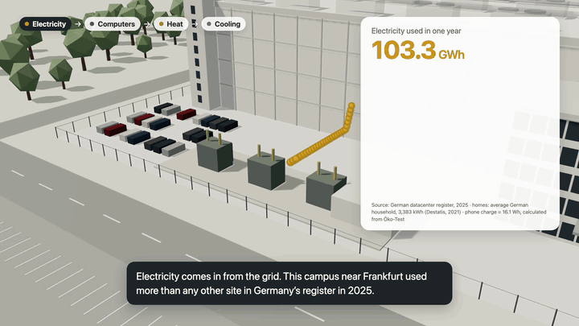

# How a datacenter works

An interactive 3D explainer of datacenters, built on real, sourced figures. It runs offline as a single HTML file.

Click a part of a datacenter (cooling, water, power, heat, backup, noise…) and the camera flies to it. A card then explains what that part does, with figures from a real site. **Every number shows its source, its date and its status:** reported by the operator, set in a permit, calculated, a vendor claim, not public, and so on. Nothing is filled in where data is missing. Gaps are labelled "not public", together with where the information is held.

Inspired by [elvarofficial/teardown](https://github.com/elvarofficial/teardown).

[](https://github.com/Ikarus0013/datacenter-teardown/releases/latest/download/datacenter-tour.mp4)

▶ **[Watch the 96-second tour video](https://github.com/Ikarus0013/datacenter-teardown/releases/latest/download/datacenter-tour.mp4)** (1080p, with sound): how a datacenter works, with every number put into perspective.

## Three sites, picked on a globe

| Site | What it is | Where the figures come from |
|---|---|---|
| **Vantage FRA21, Raunheim** (near Frankfurt) | The baseline: in 2025 it reported more energy use than any other site in Germany's datacenter register | Germany's datacenter register (RZReg), the generator permits from Regierungspräsidium Darmstadt, town council papers, German law (EnEfG), a BMWK study |
| **Google, The Dalles** (Oregon) | A hyperscale campus cooled with evaporative cooling towers | Google's 2026 environmental report and PUE page, Oregon permits, a grid filing, NOAA climate normals, press; building outlines from OpenStreetMap |
| **The ideal datacenter** (fictional, near Luleå) | A made-up 1,500 MW campus. Each part is the best value achieved somewhere today, or a clearly labelled promise or research result | Operators, studies and official statistics listed in `data/ideal.json` |

Raunheim also has a teardown view (the building in layers), a "Taken apart" view of three cooling generations, energy comparisons, jobs, arguments, an environment view, day/night and season switches, and procedural sound with a distance slider.

## Use it

Download `datacenter.html` from the [releases](../../releases) and open it in a browser. No internet connection needed.

Or build it yourself (needs Node 18+ and Python 3):

```sh
npm install
npm run build        # runs the data check, then writes dist/datacenter.html
open dist/datacenter.html
```

Links open a view directly, for example `#water/evaporative`, `#cooling/today/apart`, `#tour`, `#thedalles`, `#d-water`, `#ideal`, `#i-power/promises`.

## Video

`video/` makes a short tour video (16:9, 1080p) from the real page with [Remotion](https://www.remotion.dev): the page runs in a video mode (`?video`), a script renders it frame by frame in Chrome, and Remotion adds the tour texts as captions and the page's own fan hum.

```sh
npm run build
cd video && npm install
npm run capture   # frames + hum from dist/datacenter.html
npm run render    # writes video/out/datacenter-tour.mp4
```

Remotion is free for individuals and companies with up to 3 employees; larger companies need a [company licence](https://www.remotion.dev/license).

## How the data works

- `data/baseline.json` – Raunheim and the general figures (sources, facts, scenarios, regulation, claims)
- `data/thedalles.json` – Google The Dalles
- `data/ideal.json` – the fictional ideal datacenter (each fact is also tagged *proven*, *promised*, *research*, *calculated* or *model choice*)
- `data/check.py` – runs before every build. It checks that every figure has a known status and an existing source, recalculates every derived value from its inputs, and compares register figures with the register snapshot.

Each fact looks like this:

```json
{ "value": 1.25, "status": "reported", "source": "rzreg", "asOf": "2025", "note": "…" }
```

### Original documents

The permits, studies, laws and reports the figures come from are **not in this repository**, because they belong to their publishers. The same goes for the register snapshot, which has no stated licence. Download them from their official sources with:

```sh
python3 scripts/fetch_sources.py
```

Without them everything still builds; the check only skips comparing figures with the register snapshot.

### Known gaps (not public)

- Raunheim: roof-cooler sound levels (in unpublished TÜV/BEKON reports; can be requested from RP Darmstadt under Hesse's freedom-of-information law, HUIG).
- The Dalles: electricity use, number of generators (a trade secret, by agreement with Oregon DEQ) and building heights.

## Contributing

New studies, better sources and corrections are very welcome. Add the fact with its source, status and date to the right data file, run `npm run check`, and open a pull request. Please don't add figures without a source. Where something isn't public, add it as `"status": "not-public"` and note who holds it.

## Licences and attribution

- **Code** (`src/`, `scripts/`, `build.mjs`, `data/*.py`): MIT, see [LICENSE](LICENSE).
- **Our own data files and texts** (`data/baseline.json`, `data/thedalles.json`, `data/ideal.json`): [CC BY 4.0](https://creativecommons.org/licenses/by/4.0/). The facts in them come from the sources named next to each one.
- **Map data** (`data/osm/`, `data/thedalles-geo.json`, and the built page): © [OpenStreetMap contributors](https://www.openstreetmap.org/copyright), available under the [Open Database Licence (ODbL)](https://opendatacommons.org/licenses/odbl/).
- **Globe outlines** (`data/globe/`): [Natural Earth](https://www.naturalearthdata.com/), public domain.
- **Climate normals** (`data/thedalles/*.csv`): NOAA NCEI, US government work, public domain.
- **three.js** (MIT) and **esbuild** (MIT) are bundled or used at build time.

This is an independent explainer, not affiliated with Vantage, Google or any other operator named in it.
